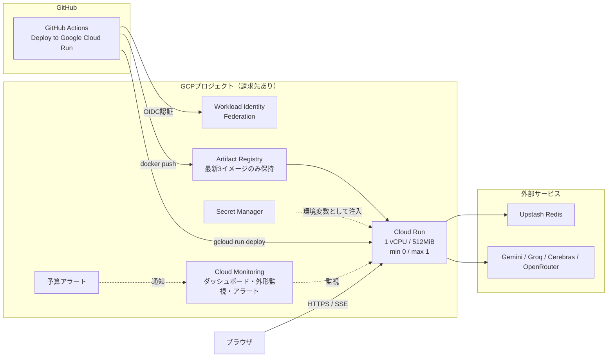

# Google Cloud Runへのデプロイ

Nuance MapperをGoogle Cloud Runで動かす構成です。GCPの無料枠に収まるよう、リクエスト処理中だけ課金されるCloud Run単体を実行基盤にし、監視ダッシュボード、アラート、予算通知までをTerraformで管理します。

## 構成



Terraformが管理するのはサービスの設定、シークレット、権限、監視です。イメージの更新だけはGitHub Actionsの`gcloud run deploy`が担当し、Terraformはイメージの差分を無視します。デプロイ用のサービスアカウントにはイメージのpushとリビジョンの更新以外を許可していないため、CIにプロジェクト全体の権限を渡さずに済みます。

## 作成されるリソース

| ファイル | 主なリソース | 内容 |
| --- | --- | --- |
| [`main.tf`](./main.tf) | `google_cloud_run_v2_service` | Next.jsコンテナを実行するサービス。リクエストベース課金、スケールゼロ |
| | `google_artifact_registry_repository` | イメージの保管先。新しい順に`image_keep_count`件だけ残す |
| | `google_secret_manager_secret(_version)` | LLM APIキーとUpstashの認証情報 |
| | `google_service_account` | シークレットの読み取りだけを許した実行用アカウント |
| [`github.tf`](./github.tf) | `google_iam_workload_identity_pool(_provider)` | GitHub ActionsのOIDCトークンを受け付ける。対象リポジトリのmainだけ |
| | `google_service_account` | デプロイ用アカウント。push、リビジョン更新、実行用アカウントのactAsのみ |
| [`monitoring.tf`](./monitoring.tf) | `google_monitoring_dashboard` | 監視ダッシュボード |
| | `google_monitoring_uptime_check_config` | `/api/health`の外形監視 |
| | `google_monitoring_alert_policy` | 外形監視の失敗、5xxの増加、生成の失敗 |
| | `google_logging_metric` | アプリのログ行から作るメトリクス |
| | `google_billing_budget` | 月額予算の通知（`billing_account_id`を指定した場合のみ） |

## 前提

- 請求先アカウントを紐付けたGCPプロジェクト
- gcloud CLI、Terraform 1.11以上、Docker（ローカルでイメージを作る場合）
- GitHub Actionsを利用できるリポジトリ

**Gemini APIキーは、請求先アカウントを紐付けていない別のプロジェクトで発行してください。** Cloud Runを使うプロジェクトには課金が必須で、同じプロジェクトで発行したキーは無料枠を超えると請求の対象になります。

## 初回設定

### 1. プロジェクトを準備する

Terraformが他のAPIを有効化するための前提となる2つのAPIだけは、先に手動で有効化します。

```bash
gcloud auth login
gcloud auth application-default login
gcloud config set project <プロジェクトID>
gcloud services enable serviceusage.googleapis.com cloudresourcemanager.googleapis.com
```

### 2. state保存用バケットを作成する

Cloud Storageの無料枠はUSリージョンだけが対象なので、stateのバケットは`us-central1`に作ります。誤って上書きした場合に戻せるよう、バージョニングを有効にします。

```bash
gcloud storage buckets create gs://<一意なバケット名> \
  --location=us-central1 --uniform-bucket-level-access
gcloud storage buckets update gs://<一意なバケット名> --versioning
```

バックエンドが自身を保存するバケットを同じ構成で作ることはできないため、この作業だけはTerraform実行前に必要です。

### 3. 設定ファイルを準備する

```bash
cd terraform/cloudrun
cp backend.hcl.example backend.hcl
cp terraform.tfvars.example terraform.tfvars
```

`backend.hcl`にバケット名を、`terraform.tfvars`にプロジェクトIDと使用するシークレットの一覧を設定します。どちらもGitへコミットしないでください。

### 4. 作成する

`secret_env_names`に挙げたシークレットの値は、作成時に環境変数で渡します。値はephemeral変数とwrite-only属性を経由するため、stateにもplanにも残りません。

```bash
export TF_VAR_gemini_api_key="..."             # 請求先なしのプロジェクトで発行したキー
export TF_VAR_groq_api_key="..."
export TF_VAR_cerebras_api_key="..."
export TF_VAR_openrouter_api_key="..."
export TF_VAR_upstash_redis_rest_url="..."
export TF_VAR_upstash_redis_rest_token="..."

terraform init -backend-config=backend.hcl
terraform apply
```

最初のapplyでは、Artifact Registryが空でもサービスを作れるよう、Google公開のサンプルイメージ（`initial_image`）で起動します。サンプルは`/api/health`に`"status":"ok"`を返さないため、最初のデプロイが終わるまで外形監視のアラートが出ることがあります。

### 5. GitHubに変数を登録する

applyの出力を、リポジトリの「Settings」→「Secrets and variables」→「Actions」→「Variables」へ登録します。いずれも機密情報ではありません。

```bash
terraform output github_variables
```

| Variable | 内容 |
| --- | --- |
| `GCP_PROJECT_ID` | プロジェクトID |
| `GCP_REGION` | リージョン（既定は`asia-northeast1`） |
| `GCP_SERVICE` | Cloud Runサービス名（`service_name`、既定は`nuance-mapper`）。Artifact Registryのリポジトリ名とイメージ名も兼ねる |
| `GCP_WORKLOAD_IDENTITY_PROVIDER` | Workload Identityプロバイダのリソース名 |
| `GCP_DEPLOYER_SERVICE_ACCOUNT` | デプロイ用サービスアカウントのメールアドレス |

## GitHub Actionsからデプロイする

1. 「Actions」タブで`Deploy to Google Cloud Run`を選択します。
2. `main`ブランチを選んで`Run workflow`を実行します。

イメージタグにはコミットSHAが使われ、デプロイ後に`/api/health`の`revision`が一致するまで確認します。Workload Identityの条件で`main`以外のブランチからの認証は拒否されます。

以前のイメージへ切り戻す場合は、`image_tag`にタグを入力して実行します。タグを指定するとビルドを行わず、Artifact Registryに残っているイメージをそのまま配ります。切り戻せるのは直近`image_keep_count`件（既定は3件）までです。

本番をCloud Runへ移す場合は、ワークフローの`on`に`push: branches: [main]`を追加すると、mainへのmergeで自動デプロイされます。

## 監視

### ダッシュボード

`terraform output dashboard_url`で開けます。Cloud Run標準のメトリクスと、アプリのログから作ったメトリクスを並べています。

| グラフ | 見るポイント |
| --- | --- |
| リクエスト数（レスポンスクラス別） | 5xxや429の割合 |
| レイテンシ（p50 / p95 / p99） | LLMの応答待ちを含むため、生成時は数秒〜数十秒が正常 |
| インスタンス数 | `max_instances`に張り付いていないか |
| 課金対象インスタンス時間 | 横線（無料枠の日割り）を継続して超えていないか |
| CPU / メモリ使用率 | メモリ上限（512MiB）への余裕 |
| コンテナ起動レイテンシ | コールドスタートの長さ |
| キャッシュヒットとLLM生成 | キャッシュの効き具合 |
| 応答したプロバイダ / 失敗したプロバイダ | どのプロバイダのクォータが尽きているか |
| 生成の失敗 | 全プロバイダが失敗した回数 |
| 外形監視の成功率 | `/api/health`の応答 |

キャッシュ、プロバイダ、生成の失敗のグラフは、[`src/app/api/generate/route.ts`](../../src/app/api/generate/route.ts)が出力する`Cache hit:`、`Winner:`、`Model failed:`、`Error generating nuances`のログ行を数えています。**これらのログの文言を変えた場合は、[`monitoring.tf`](./monitoring.tf)のフィルタも合わせて変更してください。** 変更しないとグラフが0のまま止まります。

### アラート

| アラート | 条件 |
| --- | --- |
| 外形監視の失敗 | `/api/health`が2地域以上で失敗 |
| 5xxレスポンスの増加 | 5分間の5xxが`alert_5xx_threshold`件（既定5件）を超過 |
| 生成の失敗 | `Error generating nuances`のログが出力された（通知は1時間に1通まで） |

`alert_email`を指定すると、アラートと予算通知がそのアドレスに届きます。未指定の場合はコンソール上のインシデントとしてだけ記録されます。

## シークレットのローテーション

値を変更する場合は、`secret_version`を現在の値より大きくし、`secret_env_names`の**全部の**値を環境変数で渡してapplyします。

```bash
export TF_VAR_gemini_api_key="..."   # 変更しないものも含めて全部渡す
# ...
terraform apply -var="secret_version=2"
```

write-only属性は値を読み戻せないため、Terraformは版番号の変化でしか更新を検知できません。同じ番号のまま新しい値を渡しても「変更なし」と判断されます。版番号を上げるとシークレットのバージョンが作り直され、Cloud Runにも新しいリビジョンが作られます。古いバージョンは新しいリビジョンへの切り替えが終わってから破棄されるので、ローテーション中も稼働中のリビジョンは起動でき、apply後の有効なバージョン数（無料枠は6個）も増えません。

`terraform.tfvars`で`secret_version`を管理している場合は、そちらの値を増やしてください。

## リソースを削除する

Cloud Runサービスには`deletion_protection`を設定しているため、まず[`main.tf`](./main.tf)の値を`false`にしてapplyします。

```bash
terraform apply
terraform destroy
```

Workload Identityプールは削除後30日間は同じIDで作り直せません。その間に再作成する場合は`gcloud iam workload-identity-pools undelete github --location=global`で復元してから`terraform import`してください。stateのバケットはTerraformの管理外なので残ります。

## コスト管理

既定の構成で使う無料枠は次のとおりです。

| サービス | 無料枠 | この構成での使い方 |
| --- | --- | --- |
| Cloud Run | 月18万vCPU秒、36万GiB秒、200万リクエスト | 1 vCPUで月約50時間の処理中時間 |
| Artifact Registry | 0.5GB | 3イメージを保持 |
| Secret Manager | 有効なバージョン6個、月1万回のアクセス | 最大6個 |
| Cloud Monitoring | GCP標準メトリクス、外形監視は月100万回 | 外形監視は15分間隔×3地域で月約8,600回 |
| Cloud Storage | USリージョンで5GB | Terraform stateのみ |

無料枠の対象外になるのは、主に東京リージョンからのインターネット向け転送量（Cloud Runの無料転送は北米発の1GiB/月のみ）で、この規模では月数十円程度です。ログベースメトリクスはカスタムメトリクスとして計上されますが、この規模では無料枠内に収まります。

外形監視はスケールゼロ中のサービスを起動させることがあり、その起動時間も課金対象インスタンス時間に含まれます。無料枠への影響は数%程度です。既定の15分が設定できる最長の間隔なので、これ以上減らすには外形監視自体を外す必要があります。

`max_instances = 1`は費用の上限を兼ねています。攻撃などで1インスタンスが1か月間フル稼働し続けた場合でも、概算で月60ドル程度が上限です。予算アラートは通知するだけで課金を止めません。最新の単価は[Cloud Runの料金](https://cloud.google.com/run/pricing)と[無料枠の一覧](https://cloud.google.com/free)で確認してください。

## 注意

- レート制限([`src/lib/rate-limit.ts`](../../src/lib/rate-limit.ts))はインスタンス内のメモリで数えます。`max_instances`を2以上にすると、インスタンスごとに別々に数えることになります。
- 生成APIは`x-forwarded-for`の先頭要素をクライアントIPとして使っています。Cloud Runはクライアントが送った値の末尾に実際の接続元を追記するため、ヘッダーを偽装するとレート制限を回避できます。
- Cloud Runのコンテナ内のファイルシステムはメモリ上にあるため、Upstashを設定しない場合のローカルファイルキャッシュはメモリを消費し、インスタンスの停止で消えます。
- `backend.hcl`、`terraform.tfvars`、認証情報をリポジトリへコミットしないでください。
